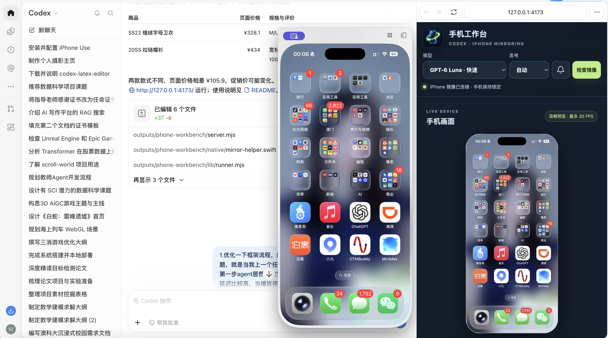
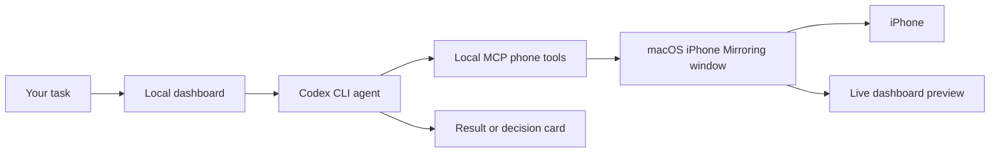

<p align="center">
  
</p>

<h1 align="center">iPhone Mirror Workbench</h1>

<p align="center">Let Codex see and operate your iPhone through Apple's iPhone Mirroring on a Mac.</p>

<p align="center"><a href="README.md">简体中文</a> · <strong>English</strong></p>

iPhone Mirror Workbench is a local dashboard for Codex-driven phone tasks. It brings the live macOS iPhone Mirroring window, task composer, model controls, activity history, schedules, and decision reminders into one place. Describe a task in natural language; the agent locates the target app first, then acts on the actual mirrored screen.

> [!IMPORTANT]
> This project uses Apple's iPhone Mirroring. It is not an iPhone app and does not control the phone through USB or WebDriverAgent. Initial pairing, system authentication, app sign-in, and payments remain with the device owner.

## Preview


*The screenshot shows only the task controls. It excludes the real phone display and private task history. The live iPhone image appears in the left panel when connected.*



*In action: iPhone Mirroring and the workbench displayed side by side in Codex.*

## Copy one prompt to install with Codex

Click **Copy** in the top-right corner of this GitHub code block, then paste the complete prompt into Codex on your Mac:

```text
Help me install and start iPhone Mirror Workbench on this Mac:
https://github.com/zse04152005-del/codex-iphone-mirror-workbench

Read README.en.md and start.command first. Check that this Mac and iPhone support Apple's iPhone Mirroring, and check Node.js 18+, swiftc / Xcode Command Line Tools, and an authenticated Codex CLI. Clone the repository into a local directory I can access. If it already exists, inspect it first; do not overwrite or upload the task records in data/.

Run npm run check, start the workbench, and open http://127.0.0.1:4173/. Verify the connection status and live screen. If software installation, macOS Screen Recording or Accessibility permission, initial pairing, unlocking, or authentication is needed, tell me the exact steps and let me complete them in the system UI. Do not ask for passwords, verification codes, or tokens. Investigate actual errors and report what was verified and what still needs my action.
```

GitHub provides the copy button for fenced code blocks, so the entire installation request can be copied in one click. The prompt works in Codex Desktop or the CLI.

## Requirements

| Requirement | Why it is needed |
| --- | --- |
| A Mac and iPhone compatible with iPhone Mirroring | Set up Apple's connection using the [official compatibility guide](https://support.apple.com/en-us/120421) |
| macOS Screen Recording and Accessibility permissions | Read the mirror window and send clicks or keyboard input to it |
| Node.js 18+ and npm | Run the local dashboard; there are no third-party npm runtime dependencies |
| Xcode Command Line Tools (`swiftc`) | Compile the Swift mirror helper and live stream on first use |
| Installed and authenticated Codex CLI | Run agent tasks; see the [official Codex CLI guide](https://developers.openai.com/codex/cli) |

The Mac and iPhone must meet Apple's iPhone Mirroring requirements. The iPhone can remain locked during mirroring; connection and authentication behavior are governed by macOS and Apple settings.

### Install manually

```bash
git clone https://github.com/zse04152005-del/codex-iphone-mirror-workbench.git
cd codex-iphone-mirror-workbench
npm run check
npm start
```

Open **http://127.0.0.1:4173/** in a Mac browser or Codex's browser. Keep the terminal running, or double-click `start.command` in Finder. The first launch may take longer while the native Swift helpers compile. You do not need to run `npm install`.

If Codex CLI is not installed or signed in, complete the [official setup](https://developers.openai.com/codex/cli) before starting an agent task. You can inspect the dashboard before running an agent.

## Features

| Feature | What it does |
| --- | --- |
| Live phone view | Streams the mirror window at up to about 20 FPS, with still-frame fallback |
| Natural-language tasks | Review messages, research products, prepare a Feishu report draft, or assemble a food order |
| Target-app preflight | Searches the target app in Spotlight before the agent acts, preventing a new task from starting in the previous app |
| Model and reasoning controls | Pick a listed Codex model and automatic, low, medium, high, or extra-high reasoning; actual availability depends on your Codex environment |
| Task shortcuts | Start with editable templates for WeChat, Feishu, food delivery, Douyin, Taobao, and more |
| Decision cards | The agent should present content for your review before sending messages, submitting forms, or placing orders |
| Schedules | Queue one-time, daily, or weekly tasks while the Mac and service remain running |
| Manual takeover and history | Click the mirrored screen yourself, inspect activity, and collapse or expand task history |

Example tasks:

```text
Open Taobao, find a mechanical keyboard, compare prices, specs, and reviews, and do not order.
Open Douyin, search for a topic, summarize relevant results, and do not like or post anything.
Open Feishu, prepare today's report using supported facts, and ask me before submitting it.
```

## How it works



The dashboard reads the mirrored window with macOS ScreenCaptureKit and sends input through Accessibility. Its web server listens only on `127.0.0.1:4173`. The local server has no telemetry code. Tasks and decisions are stored in `data/`, which is excluded from Git. **While running a task, Codex processes your instructions and the screenshots it needs according to your configured Codex service.** Consider your account's data policies before using it for sensitive material.

Decision cards are an agent workflow rule, **not a hardware or OS security boundary**. Check recipients, content, prices, and page state before any real-world action. Handle passwords, one-time codes, Face ID, payments, and legal agreements yourself.

## Troubleshooting

<details>
<summary>The dashboard says “Waiting for mirror” or the connection ended</summary>

Open Apple's iPhone Mirroring on the Mac, keep the iPhone nearby and locked, and complete any Apple authentication. Then click “Check mirror” in the dashboard. If the phone is in use, finish on the phone and lock it again.

</details>

<details>
<summary>The picture works, but the agent cannot click or type</summary>

Check Accessibility permission for the terminal running the dashboard and its compiled mirror helper. Screen Recording permission is also required to read the picture. Restart the dashboard after granting access. Follow the exact prompts shown by macOS.

</details>

<details>
<summary>The first launch is slow or `swiftc` is missing</summary>

The first run compiles `native/*.swift`. Check `xcode-select -p` and `swiftc --version`, install Apple's Xcode Command Line Tools if needed, and try again. Build products and caches are excluded from the repository.

</details>

<details>
<summary>A scheduled task did not run</summary>

Schedules require an awake Mac and a running workbench service. On restart, the current scheduler catches up missed work; sending, submitting, and ordering still produce a decision card for review.

</details>

## Development

```bash
npm run check
npm start
```

`server.mjs` serves the local UI and task API; `mcp-server.mjs` exposes phone tools to the agent; `native/` contains capture, streaming, and input helpers; `lib/` manages the task queue, schedules, and state; `public/` contains the build-free frontend.

This project currently targets the macOS iPhone Mirroring app. Actual preview frame rate depends on Apple's mirroring link and Mac performance. Some apps refuse remote input in protected fields or system pages.

## License and credits

[MIT License](LICENSE). Built on capabilities provided by [Apple iPhone Mirroring](https://support.apple.com/en-us/120421), [ScreenCaptureKit](https://developer.apple.com/documentation/screencapturekit), and [OpenAI Codex](https://developers.openai.com/codex/cli). This is an independent project and is not affiliated with Apple, OpenAI, or [iPhone Use](https://github.com/zhongerxin/iPhone-use), which takes a different USB/WDA approach.
