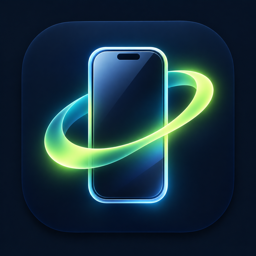
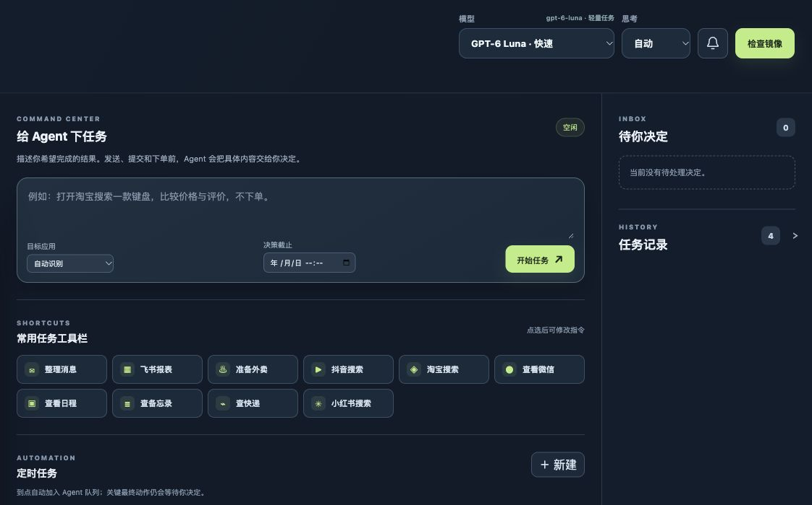
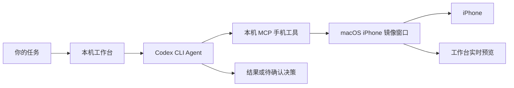

<p align="center">
  
</p>

<h1 align="center">iPhone Mirror Workbench</h1>

<p align="center">在 Mac 上通过 Apple「iPhone 镜像」让 Codex 看见并操作你的 iPhone。</p>

<p align="center"><strong>简体中文</strong> · <a href="README.en.md">English</a></p>

iPhone Mirror Workbench 是一个运行在本机的 Codex 手机工作台。它把 Mac 自带的「iPhone 镜像」画面、任务对话框、模型选择、执行记录、定时任务和决策提醒放在同一界面。用自然语言安排手机任务，Agent 会先定位目标 App，再根据真实画面点击、滚动和输入。

> [!IMPORTANT]
> 本项目依赖 Apple「iPhone 镜像」，不是 iPhone 端 App，也不通过 USB 或 WebDriverAgent 控制手机。首次配对、系统认证、App 登录和支付仍由设备所有者完成。

## 界面预览



*截图仅展示任务控制区，未包含真实手机画面或私人任务记录。连接后，左侧会显示实时 iPhone 镜像。*

## 复制一段提示词，让 Codex 帮你安装

在 GitHub 代码块右上角点 **Copy**，将整段提示词发给这台 Mac 上的 Codex：

```text
请帮我在这台 Mac 安装并启动 iPhone Mirror Workbench：
https://github.com/zse04152005-del/codex-iphone-mirror-workbench

先阅读仓库 README.md 和 start.command，再检查：Mac 与 iPhone 是否支持 Apple「iPhone 镜像」、Node.js 18+、swiftc / Xcode Command Line Tools，以及已登录的 Codex CLI。把仓库克隆到我可访问的本机目录；若已经安装，先检查现有目录，不覆盖或上传 data/ 中的任务记录。

运行 npm run check，然后启动工作台，打开 http://127.0.0.1:4173/。帮助我确认顶部连接状态和手机画面。需要安装依赖、开启 macOS「屏幕录制」或「辅助功能」权限、首次配对、Mac/iPhone 解锁或认证时，告诉我准确的操作步骤，由我在系统界面完成。不要索取密码、验证码或令牌。遇到错误请查看实际报错并修复，最后说明已完成的验证和仍需我操作的步骤。
```

这段提示词适用于 Codex 桌面端或 CLI。GitHub 代码块自带复制按钮；它复制的是完整安装任务，不需要手工拼接命令。

## 安装要求

| 依赖 | 用途 |
| --- | --- |
| 支持「iPhone 镜像」的 Mac 与 iPhone | 提供 Apple 官方镜像连接；按 [Apple 的兼容性与设置说明](https://support.apple.com/zh-cn/120421) 完成首次配对 |
| macOS「屏幕录制」和「辅助功能」权限 | 分别用于读取镜像画面和向镜像窗口发送点击、键盘操作 |
| Node.js 18+ 与 npm | 运行本地工作台；项目没有第三方 npm 运行依赖 |
| Xcode Command Line Tools（`swiftc`） | 首次运行时编译 Swift 镜像助手与连续画面流 |
| 已安装、已登录的 Codex CLI | 执行 Agent 任务；参见 [OpenAI 官方 Codex CLI 指南](https://developers.openai.com/codex/cli) |

需要 Mac 和 iPhone 满足 Apple 的「iPhone 镜像」条件。镜像工作时 iPhone 可保持锁定；连接、重连和认证行为受 macOS 与 Apple 设置控制。

### 手动启动

```bash
git clone https://github.com/zse04152005-del/codex-iphone-mirror-workbench.git
cd codex-iphone-mirror-workbench
npm run check
npm start
```

在 Mac 浏览器或 Codex 浏览器打开 **http://127.0.0.1:4173/**。保持运行 `npm start` 的终端窗口打开；也可以在 Finder 双击 `start.command`。首次启动会按需编译本机 Swift 工具，可能比后续启动慢。无需运行 `npm install`。

若 Codex CLI 尚未安装或登录，请先按 [官方指南](https://developers.openai.com/codex/cli) 完成配置，再从工作台启动 Agent 任务。仅查看界面不需要先运行 Agent。

## 可以做什么

| 功能 | 用法 |
| --- | --- |
| 实时手机画面 | 在工作台观看镜像窗口；连续预览上限约 20 FPS，流不可用时退回逐帧截图 |
| 自然语言任务 | 例如整理消息、查商品、填写飞书报表草稿或准备外卖订单 |
| 目标 App 预切换 | 任务开始前先在 Spotlight 搜索目标 App，避免把新任务的第一步做在上一个 App 中 |
| 模型和思考档位 | 选择工作台列出的 Codex 模型，以及自动、低、中、高、极高思考档位；可用模型取决于你的 Codex 环境 |
| 常用任务工具栏 | 快速填入微信、飞书、外卖、抖音、淘宝等任务模板，再按需改写 |
| 决策卡 | 发送消息、提交报表、下单等最终步骤前，Agent 应先给出待确认内容，再由你决定是否继续 |
| 定时任务 | 一次、每天或每周自动加入任务队列；Mac 和工作台服务必须保持运行 |
| 手动接管与记录 | 可从画面手动点击，查看执行进度，并收起或展开任务记录 |

可直接试试这些指令：

```text
打开淘宝，搜索一款机械键盘，比较价格、规格和评价，不下单。
打开抖音，搜索某个主题，整理前几条相关内容，不点赞或发布。
打开飞书，找到今天的日报，填写有依据的草稿，提交前让我确认。
```

## 工作方式



工作台通过 macOS ScreenCaptureKit 读取镜像画面，通过辅助功能向镜像窗口发送操作。Agent 工具和网页服务均运行在本机，网页只监听 `127.0.0.1:4173`。本机服务不包含遥测代码；任务和决策记录保存在 `data/`，已被 `.gitignore` 排除。**Codex 执行任务时会按你所用 Codex 服务的配置处理提示词与必要的截图**；请按自己的账号与数据政策决定是否处理敏感内容。

决策卡是 Agent 的工作流程约束，**不是阻止所有误操作的硬件或系统级安全边界**。请在真实发送、提交或下单前核对收件人、内容、价格和页面状态。密码、验证码、Face ID、支付以及法律协议由你本人处理。

## 常见问题

<details>
<summary>显示「等待镜像画面」或连接已结束？</summary>

先在 Mac 打开 Apple「iPhone 镜像」，让 iPhone 保持附近、锁定，并完成 Apple 要求的认证。回到工作台点击「检查镜像」。如果系统显示手机正在使用，请先结束手机上的操作并重新锁定。

</details>

<details>
<summary>画面可见，但 Agent 不能点击或输入？</summary>

检查给工作台所在终端和编译后的镜像助手的「辅助功能」权限；读取画面还需要「屏幕录制」权限。授权后重启工作台。具体权限提示以 macOS 实际显示为准。

</details>

<details>
<summary>首次启动很慢或提示找不到 swiftc？</summary>

首次使用需编译 `native/*.swift`。运行 `xcode-select -p` 与 `swiftc --version` 检查 Xcode Command Line Tools；缺失时安装 Apple 官方开发工具后再试。编译产物与缓存不会上传到仓库。

</details>

<details>
<summary>定时任务为什么没有执行？</summary>

定时任务依赖 Mac 未睡眠、工作台服务仍在运行。服务恢复后会按当前实现对错过的任务补执行；发送、提交与下单仍需你处理决策卡。

</details>

## 开发

```bash
npm run check
npm start
```

`server.mjs` 提供本地 UI 与任务 API；`mcp-server.mjs` 提供 Agent 手机工具；`native/` 包含镜像截图、连续画面流和输入操作；`lib/` 管理任务队列、定时任务及持久化状态；`public/` 是无构建步骤的前端。

项目目前只针对 macOS 自带「iPhone 镜像」开发。视频预览的实际帧率取决于 Apple 镜像链路和 Mac 性能；在部分 App 中，安全输入框或系统级页面可能拒绝远程输入。

## 许可与致谢

[MIT License](LICENSE)。感谢 [Apple iPhone Mirroring](https://support.apple.com/zh-cn/120421)、[ScreenCaptureKit](https://developer.apple.com/documentation/screencapturekit) 与 [OpenAI Codex](https://developers.openai.com/codex/cli) 提供的基础能力。本项目是独立项目，与 Apple、OpenAI 或 [iPhone Use](https://github.com/zhongerxin/iPhone-use) 没有官方隶属关系；后者使用不同的 USB/WDA 路线。
